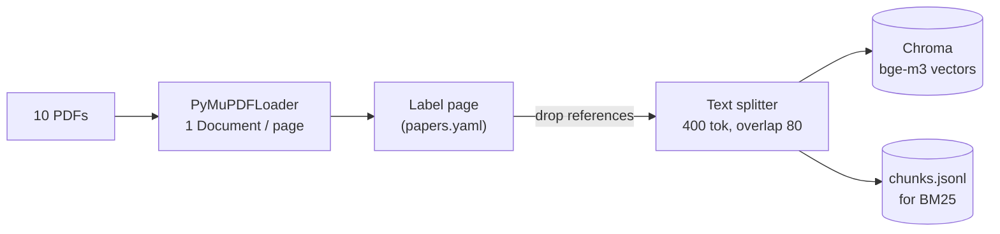
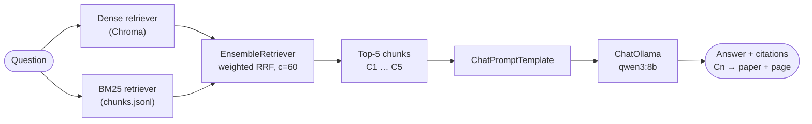

# RAG over 10 Multimodal & Embodied AI Papers (LangChain)

Technical assessment, Option 1 (RAG Implementation), AI Engineer – Multimodal Intern, Kalbe.

Author: Muhammad Faiqi Harumantaka.

A question-answering system over the 10 papers in the assessment reading list. It retrieves
passages from the PDFs, asks a local LLM to answer **only from those passages**, and returns
the answer with **paper + page citations** that map back to the retrieved evidence.
Everything runs locally and free (Ollama + open models).

A first version without any framework (same data, same evaluation set) is kept as a
**baseline** for comparison: <https://github.com/blurtie/rag-assessment> (design notes in its `NOTES.md`).

---

## 1. Quick start

Requirements: Python 3.11, [Ollama](https://ollama.com), ~8 GB GPU recommended (CPU works, slower).

```bash
conda create -n rag-lc python=3.11 -y && conda activate rag-lc     # or python -m venv
pip install -r requirements.txt
ollama pull qwen3:8b
cp .env.example .env                       # only needed if Ollama is not on localhost:11434

python scripts/download_papers.py          # 10 PDFs -> data/raw/
python -m rag.cli ingest                   # PDFs -> chunks -> Chroma (data/chroma)
python -m rag.cli ask "What is the MMVP benchmark?" --save
```

| Command | What it does |
|---|---|
| `python -m rag.cli search "<q>" [--method dense\|bm25\|hybrid]` | Retrieval only, no LLM |
| `python -m rag.cli ask "<q>" [--save]` | Retrieval + answer + sources (saved to `outputs/`) |
| `python -m rag.cli ask "<q>" --closed-book` | Same LLM without retrieved context (baseline) |
| `python -m rag.evaluate retrieval` | hit@k / MRR for dense, BM25, hybrid on the eval set |
| `python -m rag.evaluate generate --method hybrid` | Answers + closed-book answers → CSV for manual labelling |
| `python -m rag.evaluate summarize <labelled.csv>` | Correct / retrieval failure / generation failure breakdown |

`notebooks/walkthrough.ipynb` traces **one question through every stage** (page → chunk →
vector → ranking → prompt → answer → citation) using the same code as the CLI, with outputs saved.

**Hardware used:** RTX 4060 Laptop 8 GB, 24 GB RAM, Windows. `qwen3:8b` uses ~6.2 GB VRAM
at `num_ctx` 8192 and runs 100% on GPU. The first question after Ollama loads the model takes
~90 s; later questions ~5–6 s (measured during development with the same model and settings).
Downloads: PyTorch CUDA build (several GB), bge-m3 (~2.3 GB), qwen3:8b (5.2 GB).

## 2. Document collection

| | |
|---|---|
| Source | The 10 papers of the assessment reading list (P1–P5 multimodal, P6–P10 embodied AI), from arXiv / PMLR / ACL Anthology links in `papers.yaml` |
| Size | 10 PDFs, 284 pages |
| Licence handling | PDFs are **not** committed; `scripts/download_papers.py` fetches them |
| Version note | P7 (DreamerV3) uses the 40-page arXiv preprint (v2), not the Nature version. It places Methods *after* the references, so pages 17–40 (Methods + supplementary) are labelled appendix and stay indexed |

**Preprocessing.** Each page is labelled `main`, `references` or `appendix` using page numbers
**checked by hand** for every paper (`papers.yaml`). Reference pages (39 pages) are dropped, leaving 684 chunks:
a bibliography matches many queries by keyword but never contains an answer. Appendices are
kept because they hold details (prompts, extra results). Hand-checking was necessary: in the
baseline, a keyword heuristic mislabelled the appendices of 8 of 10 papers as references, which
would have silently removed ~250 chunks from the index. P5's appendix comes *before* its
references, which the labelling handles.

## 3. Architecture

**Ingestion** (`python -m rag.cli ingest`, run once):



**Query** (`python -m rag.cli ask "..."`, per question):



Each `[Cn]` in the answer is mapped back to the chunk given as passage *n*; numbers that were never given are flagged as invalid citations.

| Stage | File | Key settings (`config.yaml`) |
|---|---|---|
| Ingestion | `rag/ingest.py` | `chunk_size: 400`, `chunk_overlap: 80` (bge-m3 tokens), `index_kinds: [main, appendix]` |
| Retrieval | `rag/pipeline.py` | `method: hybrid`, `top_k: 5`, `candidate_k: 20`, `hybrid_weights: [0.5, 0.5]`, `bm25_tokenizer: words_lowercase` |
| Generation | `rag/pipeline.py` | `qwen3:8b`, `temperature: 0`, `num_ctx: 8192`, `reasoning: false` |
| Evaluation | `rag/evaluate.py` | `data/eval/questions.yaml` |

**Prompt.** The system message allows only the numbered passages, requires a citation after
each claim, asks the model to say so when the passages are insufficient, and to answer in the
question's language. Context is limited to the top-5 chunks (~2,000 tokens) inside an 8,192-token window.

**Citations.** Because chunks never span two pages, every citation is an exact page. The
references shown to the user are built from the retrieved chunks, never from the model's text.

## 4. Models and tools

| Component | Choice | Exact version | Why |
|---|---|---|---|
| LLM | `qwen3:8b` via Ollama | Ollama ID `500a1f067a9f` | Free, local, fits 100% in 8 GB VRAM |
| Embeddings | `BAAI/bge-m3` | HuggingFace model, fp32 via `langchain-huggingface` | Multilingual: Indonesian questions over English papers |
| Vector store | Chroma (`langchain-chroma`) | 1.5.9 | Persistent, standard LangChain integration |
| Keyword search | `BM25Retriever` (`rank-bm25`) | 0.2.2 | Exact terms (names, numbers) that embeddings can miss |
| Fusion | `EnsembleRetriever` (`langchain-classic`) | 1.0.8 | Weighted Reciprocal Rank Fusion of BM25 + dense |
| Framework | LangChain 1.x | see `requirements.txt` | Standard components; easy to swap models/stores |

## 5. Evaluation

**Set** (`data/eval/questions.yaml`): 14 questions, 7 in Indonesian and 7 in English; 7 single-fact,
3 detail (one from an appendix), 2 cross-paper, 2 unanswerable. Each has gold paper + pages and
a reference answer. Questions and gold pages were drafted with AI help by searching the PDF text
(not with this system's retriever, to avoid bias), then verified by hand against the PDFs.

**Retrieval** — a hit = a retrieved chunk from a gold paper **and** a gold page (12 answerable questions):

| | dense | BM25 | hybrid |
|---|---|---|---|
| hit@1 | 8/12 | 8/12 | 8/12 |
| hit@5 | 9/12 | 11/12 | **12/12** |
| MRR@10 | 0.74 | 0.76 | 0.76 |
| hit@5, Indonesian questions | 4/7 | 7/7 | 7/7 |

**Answers** (hybrid, labelled by hand: correct / faithful to cited passages):

| | This system | Closed-book (same LLM, no passages) |
|---|---|---|
| Correct, answerable questions | **11/12** (q11 partially) | **0/12** (2 partial: q06, q12) |
| Unanswerable questions correctly refused | 2/2 | 1/2 (invented a score for q14) |
| Answers with claims not supported by the cited passage | 0 | – |

The closed-book model confidently invents answers (e.g. "MMVP covers 100 visual patterns",
"RT-2 is a Russian ballistic missile"), so correct RAG answers here come from retrieval, not
from the model's memory.

**Comparison with the from-scratch baseline** (same questions, same LLM, same embedding model):

| | Baseline (no framework) | LangChain |
|---|---|---|
| hit@5 dense / BM25 / hybrid | 11 / 11 / 12 | 9 / 11 / 12 |
| Correct answers (hybrid) | 10/12 | 11/12 |
| Unfaithful answers | 1 (q12) | 0 |

With 12 answerable questions, a difference of 1–2 questions is **not** evidence that one system
is better. Two differences have a plausible cause but are not proven:
- Dense retrieval is weaker here (9 vs 11). The baseline removes running headers/footers, re-joins
  hyphenated words and lets chunks cross page boundaries; this version embeds raw page text.
- q12 was answered correctly here because a P1 chunk (page 2) was retrieved; in the baseline no P1 chunk was.

## 6. Example outputs

All runs are saved: `outputs/eval/answers_hybrid_*.json` (question, retrieved chunks with
scores, full prompt, answer, sources) and the labelled CSV. Four representative cases:

| Q | Question | Retrieved (top-5) | Answer (shortened) | Verdict |
|---|---|---|---|---|
| q03 | Berapa lama waktu training ... ANYmal di flat dan uneven terrain? | P10 p4, p7, p4, p8, **p1** | < 4 minutes flat, ~20 minutes uneven [C5 = P10 p.1] | Correct; gold page only at rank 5 |
| q12 | MMVP vs HallusionBench: what failure does each focus on? | P5 p3, P5 p1, **P1 p2**, P5 p2, P5 p4 | MMVP: CLIP-blind pairs [C3]; HallusionBench: visual illusion + knowledge hallucination [C1] | Correct; 4 of 5 chunks from one paper |
| q11 | Apa hubungan antara RT-2 dan RT-2-X? | P9 p6, P9 p6, P6 p7, P9 p6, P9 p5 | RT-2-X adds data from other robots (WidowX), better on new tasks [C1][C4] | Partial: misses "actions as text tokens"; RT-2's own description not retrieved |
| q14 | What score does RT-2 achieve on the MMVP benchmark? | P6, P1 chunks | "The context passages do not provide information..." | Correct refusal (closed-book invented "68.4") |

## 7. Where the system struggles

1. **Cross-paper questions.** Top-5 is dominated by one paper (q11: 4 of 5 chunks from P9). The
   other paper's key passage is often missing, so the answer is incomplete. This is a retrieval
   problem, not a generation problem: the model used what it was given.
2. **Dense retrieval on raw text** (see comparison above).
3. **Chunks never cross pages**: exact page citations, but a sentence split across two pages is cut in two.
4. **Figure and table text** is extracted as loose tokens (e.g. answer options from figures) and
   can rank high for keyword queries.
5. **Section names are not stored**, so citations are paper + page only.
6. **Small evaluation set** (14 questions, labelled by one person): differences of 1–2 questions are not meaningful.
7. **Gold pages can be too narrow**: q12's gold for P1 is page 1, but page 2 also answers it,
   so the script marks that run `partial` although the answer is correct. Gold pages were not
   changed after seeing results.
8. Output is not fully deterministic even at temperature 0 (small wording changes between runs).

## 8. Optional exploration: BM25 tokenization (framework default vs custom)

LangChain's `BM25Retriever` tokenizes with `text.split()` by default: case-sensitive, and
punctuation stays attached ("embodiments," ≠ "embodiments"). The baseline used lowercase word tokens.

| `bm25_tokenizer` | BM25 hit@5 | BM25 MRR@10 | BM25 hit@5 (Indonesian) | BM25 off-paper appendix chunks in top-5 | Hybrid hit@5 | Hybrid MRR@10 |
|---|---|---|---|---|---|---|
| `whitespace` (LangChain default) | 9/12 | 0.64 | 5/7 | 0.42 per question | 11/12 | 0.62 |
| `words_lowercase` (used) | 11/12 | 0.76 | 7/7 | 0.00 | 12/12 | 0.76 |

With the default tokenizer, a query word followed by punctuation or written in a different case
("MMVP?" vs "MMVP") does not match, so fewer query terms count. Measured effect: appendix chunks
from non-gold papers enter BM25's top-5 (0.42 per question vs 0.00); the likely cause, not
verified chunk by chunk, is loose figure/table tokens that happen to match the remaining terms. The weaker
BM25 list also pulls hybrid down (12 → 11 hit@5), because RRF fuses both lists with equal weight.
Dense results are unaffected (same 9/12). Same 12 questions, so this is indicative only.

## 9. What I would investigate next

1. **Cross-paper retrieval**, the main measured failure: query decomposition (one sub-query per
   paper) or multi-query + RRF, or a cap on chunks per paper in the
   top-k. Re-measure with the same questions, plus more cross-paper questions.
2. **Text cleaning before embedding** (headers/footers, hyphenation) to test whether it explains
   the dense gap to the baseline.
3. **Automatic faithfulness check**: compare each cited sentence with its chunk, instead of manual labels only.
4. **A larger evaluation set** labelled by more than one person.

## 10. AI assistance

I used Claude (Anthropic) throughout:
- **Claude wrote** most of the code in both versions (`rag/`, scripts, notebook), drafted the
  evaluation questions and gold pages from the PDF text, proposed the answer labels with reasons,
  and helped draft this README and my notes.
- **I** chose the option and the LangChain direction, ran every step on my machine and reported the
  outputs that exposed bugs (e.g. the download script stopping at the first error, appendix pages
  mislabelled as references), checked the reference/appendix page boundaries of all 10 PDFs by hand,
  verified each gold page in the PDFs, reviewed every proposed label against the cited chunk text
  (I kept all proposals: 0 changed), fixed my local environment (Ollama model storage), and ran all evaluations.
- I can trace any question through the pipeline and explain each component (see `notebooks/walkthrough.ipynb`).
